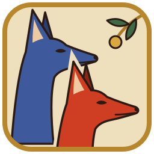
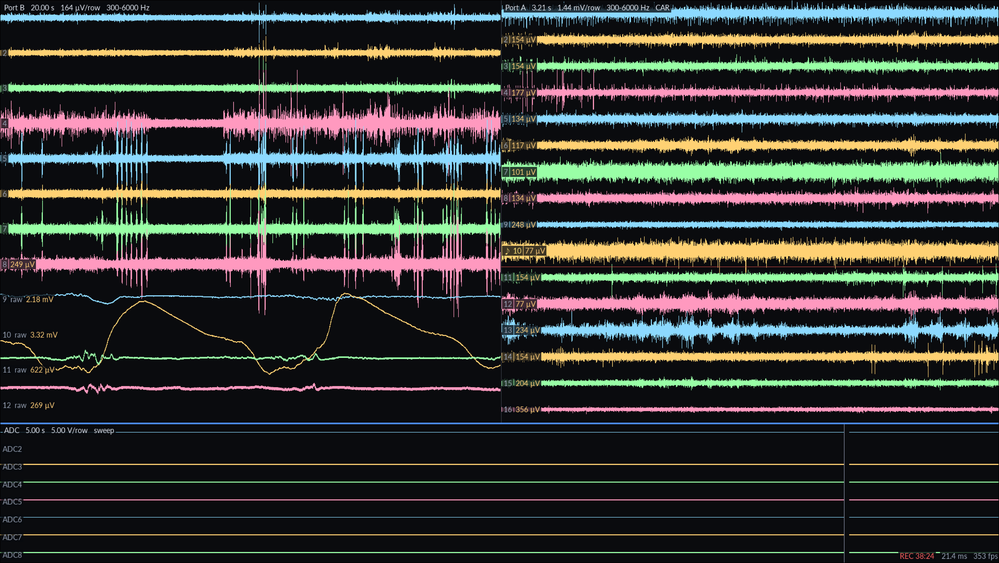
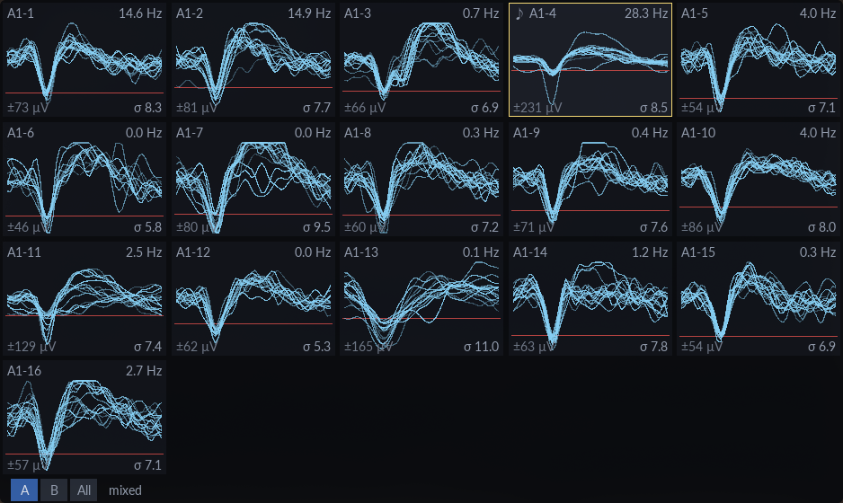
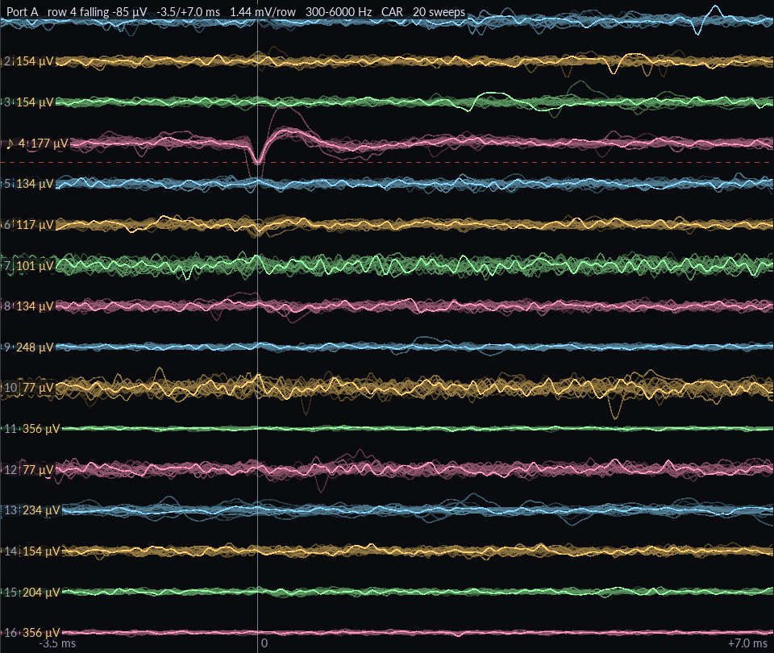
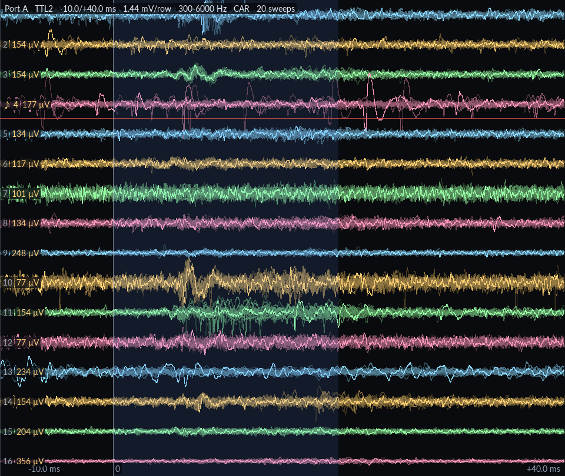

  

<h1 align="center">dimna</h1>

Acquisition, display and recording for the Open Ephys acquisition board (the ECP5 / FT600
USB 3 / ONI board), written in Zig. It runs on Linux (Wayland) and on macOS (Apple
silicon), with each system's own windows, graphics, sound and USB behind one shared core.

It is built for one job: recording single units and EMG from an animal without losing a
sample, while showing the signals with as little delay as the screen allows.

- **Records** to a simple, append-only format with a checksum per chunk; a failing disk or
  a crash costs at most the last second, and never stops acquisition.
- **Shows** the traces on the GPU, 1.6 to 2.6 ms from a sample's arrival to the screen
  on Linux (fullscreen with tearing under Hyprland; the Mac's figures are under "Linux and
  macOS"), with display-only filters, common average reference, triggered sweeps, TTL
  lanes, scroll-back review and typed notes.
- **Spike tiles and spike audio** for judging and hearing units, with one detection
  threshold per channel that can follow the noise or be dragged to a value.
- **Talks to the board** through its own USB code (no FTDI library or driver needed, on
  either system), and writes
  only volatile registers.

Its sibling is kalila (formerly oers), the same instrument in Rust; dimna began
as a port of its driver. The two are named after the jackals of the Tales of Bidpai.

*The neural display on its own monitor, from an animal: EMG on port B (left, 20 s,
300-6000 Hz on rows 1-8; rows 9-12 raw, where the stomach's slow waves show), single
units on port A (right, 300-6000 Hz with a common average reference; row 10 is in focus,
with its spike threshold as a red line, and listened to), the ADC inputs below.*

| | |
|---|---|
|  |  |
| *Spike tiles for port A: the last waveforms of each electrode, its threshold, noise and rate; A1-4 in focus (amber) and listened to (♪).* | *The control window: one summary line per section, Notes and Port A open.* |

**Triggered on spikes.** A panel can draw sweeps around each crossing of one channel's
threshold instead of scrolling. Here port A is triggered on row 4 at a fixed −85 µV
(the dashed red line, which can be dragged), 3.5 ms before to 7 ms after, the last 20
sweeps overlaid: the unit on row 4, and what the other electrodes see at the same moment
(row 6). Beside it, the tiles at the same moment: thresholds that were set by hand show
their value in red (A1-4 at −85 µV), the others follow the noise.

| | |
|---|---|
|  |  |

**Triggered on the laser.** The same panel triggered on TTL line 2 (the laser), 10 ms
before to 40 ms after each pulse, the last 20 sweeps overlaid, the pulse shaded. Rows 10
and 11 respond at a fixed latency after the light comes on (row 10 about 6-7 ms in), the
kind of response opto-tagging looks for.

## Linux and macOS

The programs, the config file, the keys and the recording format are the same on both.
Linux (x86_64) is where dimna is used for recordings from animals: Wayland and Vulkan, with
packages to install. macOS (Apple silicon) is newer: AppKit, Metal and Core Text, an app
to download, the board reached with no driver and nothing else to install; it has recorded
from the board without losing a sample, but has not yet had a soak of hours.
[docs/platforms.md](docs/platforms.md) sets the two side by side.

## Quick start

**Installing a release** (Linux, x86_64): the GitHub release page has a `.deb` (Debian 12+, Ubuntu
22.04+), an `.rpm` (Rocky/Alma/RHEL 9, Fedora) and tarballs for any glibc 2.34+ or musl
distribution. The packages set up the board's udev rule and the real-time limits; then add
yourself to the two groups they create and log out and in:

    sudo apt install ./dimna_<version>-1_amd64.deb     # or: sudo dnf install ./dimna-<version>-1.x86_64.rpm
    sudo usermod -aG dimna,realtime $USER

**The Mac app** (Apple silicon; it needs the macOS it was built on or newer, which the
release's notes name). In a terminal, so that macOS does not hold it back as a download
from a browser:

    cd ~/Downloads && curl -L -O https://github.com/matthewperkins/dimna/releases/latest/download/dimna-macos-arm64.zip \
      && unzip -o dimna-macos-arm64.zip && mv dimna.app /Applications/

Then open dimna like any app; `open -a dimna --args --sim 32,16` starts it on simulated
headstages. [docs/install.md](docs/install.md), "macOS", has the rest (a copy downloaded
with a browser, the log, the programs from a terminal).

**From source**, on Linux or macOS (Zig 0.17.1; what each system needs is in
[docs/install.md](docs/install.md)):

    zig build --release=safe
    zig-out/bin/dimna --sim 32,16            # simulated headstages, in a window: no board needed
    zig-out/bin/dimna                        # the board; ~/.config/dimna/config.toml decides the rest
    zig-out/bin/dimna-headless --seconds 600 --record ~/somewhere    # no windows

Press **`?`** on the display for every key and mouse action. `dimna --help` lists the
options. Only one program can hold the board at a time. A first config file and the three
windows are in [docs/getting-started.md](docs/getting-started.md).

## Languages

The windows can be shown in English, German, French, Brazilian Portuguese, Polish,
Simplified Chinese or Persian (mirrored, read from the right), so that someone new to a
rig can work in the language they read most easily. Put `language = "de"` (or `fr`, `pt`,
`pl`, `zh`, `fa`) in `~/.config/dimna/config.toml`, or leave it out to follow the system's
`LANG`. The translations are drafts that native speakers have not yet reviewed, and
corrections are welcome: [docs/getting-started.md](docs/getting-started.md), "Languages".

## Status

Used on one rig (RHD2132 and RHD2216 headstages, 30 kHz). Supported gateware: 2.x (2.0.0
is the only version dimna has been run on; with an older one it warns and carries on,
untested). What has been checked and how is in the commit messages; what is known to be
wrong, unexplained or never tested is in [docs/OPEN.md](docs/OPEN.md). It is not an Open
Ephys product.

## Documentation

| | |
|---|---|
| [docs/getting-started.md](docs/getting-started.md) | building and running, the three windows, a first config, languages, where recordings go |
| [docs/platforms.md](docs/platforms.md) | Linux and macOS: what each uses, the figures on each, how far each has been tried |
| [docs/install.md](docs/install.md) | installing (packages, tarballs, groups), building on Linux and on macOS, the two ways to reach the FT600, the headless tool |
| [docs/display.md](docs/display.md) | panels and their config, filters, reference, triggered sweeps, TTL, review, notes, languages |
| [docs/tiles-and-audio.md](docs/tiles-and-audio.md) | spike tiles, focus and listening, thresholds, the audio chain |
| [docs/control.md](docs/control.md) | the control window, recording, board settings, alarms, saving the view |
| [docs/recording.md](docs/recording.md) | the session layout, the recording format, how the recorder is tested |
| [docs/hardware.md](docs/hardware.md) | what is written to the board, changing settings while acquiring |
| [docs/latency.md](docs/latency.md) | what display latency was measured, and how frames are paced |
| [docs/OPEN.md](docs/OPEN.md) | known faults, unexplained observations, what was never tested |
| [docs/plans/](docs/plans/) | the plans the work was delegated from, and their rules of evidence; `macos-port.md` is the Mac port's record |
| [docs/readability-review.md](docs/readability-review.md), [docs/review-as-claude.md](docs/review-as-claude.md) | two code reviews, and what was done about them |

## Licence

Copyright (C) 2026 Matthew Perkins. dimna is free software: you can redistribute it and
modify it under the terms of the GNU General Public License, version 3, as published by
the Free Software Foundation ([LICENSE](LICENSE)). It comes with no warranty of any kind.

Third-party code: liboni (MIT) is vendored in `vendor/liboni`; stb_image and
stb_image_write by Sean Barrett (public domain / MIT) in `vendor/stb`, used only to read the
colour-scheme image and to write its swatch (see `vendor/stb/README.md`). The Wayland
protocol XMLs (`vendor/wayland-protocols`) and the Vulkan registry (`vendor/vulkan/vk.xml`)
the bindings are generated from are vendored too, with their versions and checksums in the
README of each folder.

## Icon

The icon shows Kalila and Dimna, the two jackals of the *Tales of Bidpai* that dimna and its
sibling kalila are named after. It is an original drawing, covered by the repository's licence;
credits and inspiration are in [packaging/icon/ICON-CREDITS.md](packaging/icon/ICON-CREDITS.md).
