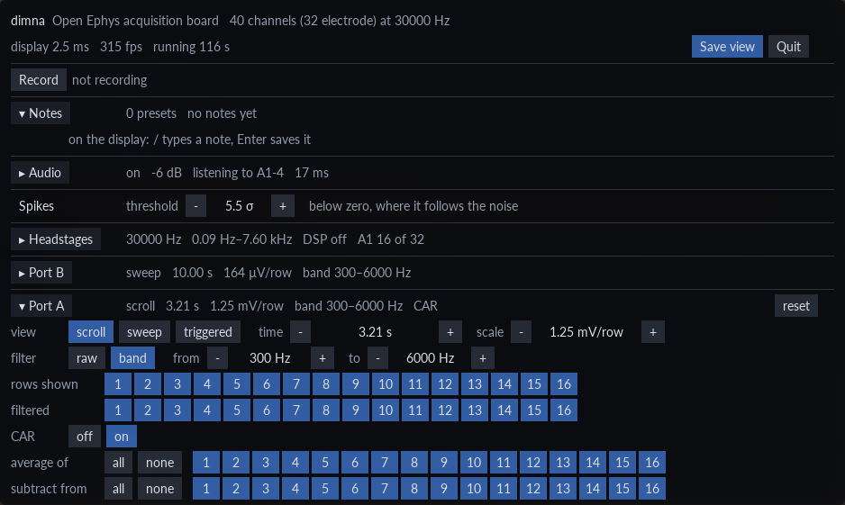
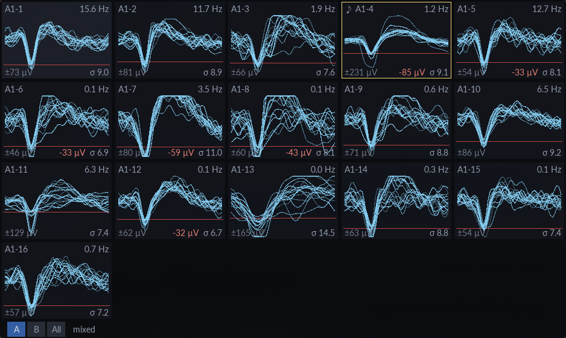

  

<h1 align="center">dimna</h1>

Acquisition, display and recording for the Open Ephys acquisition board (the ECP5 / FT600
USB 3 / ONI board), written in Zig. Linux and Wayland only.

It is built for one job: recording single units and EMG from an animal without losing a
sample, while showing the signals with as little delay as the screen allows.

- **Records** to a simple, append-only format with a checksum per chunk; a failing disk or
  a crash costs at most the last second, and never stops acquisition.
- **Shows** the traces on the GPU, 1.6 to 2.6 ms from a sample's arrival to the screen
  (fullscreen with tearing under Hyprland), with display-only filters, common average
  reference, triggered sweeps, TTL lanes, scroll-back review and typed notes.
- **Spike tiles and spike audio** for judging and hearing units, with one detection
  threshold per channel that can follow the noise or be dragged to a value.
- **Talks to the board** through its own USB code (no FTDI library needed), and writes
  only volatile registers.

Its sibling is kalila (formerly oers), the same instrument in Rust; dimna began
as a port of its driver. The two are named after the jackals of the Tales of Bidpai.

*The neural display on its own monitor, from an animal: EMG on port B (left, 20 s,
300-6000 Hz on rows 1-8; rows 9-12 raw, where the stomach's slow waves show), single
units on port A (right, 300-6000 Hz with a common average reference; row 10 is in focus,
with its spike threshold as a red line, and listened to), the ADC inputs below.*

| | |
|---|---|
|  |  |
| *Spike tiles for port A: the last waveforms of each electrode, its threshold, noise and rate; A1-4 in focus (amber) and listened to (♪).* | *The control window: one summary line per section, Notes and Port A open.* |

**Triggered on spikes.** A panel can draw sweeps around each crossing of one channel's
threshold instead of scrolling. Here port A is triggered on row 4 at a fixed −85 µV
(the dashed red line, which can be dragged), 3.5 ms before to 7 ms after, the last 20
sweeps overlaid: the unit on row 4, and what the other electrodes see at the same moment
(row 6). Beside it, the tiles at the same moment: thresholds that were set by hand show
their value in red (A1-4 at −85 µV), the others follow the noise.

| | |
|---|---|
|  |  |

**Triggered on the laser.** The same panel triggered on TTL line 2 (the laser), 10 ms
before to 40 ms after each pulse, the last 20 sweeps overlaid, the pulse shaded. Rows 10
and 11 respond at a fixed latency after the light comes on (row 10 about 6-7 ms in), the
kind of response opto-tagging looks for.

## Status

Used on one rig (RHD2132 and RHD2216 headstages, 30 kHz). What has been checked and how
is in the commit messages; what is known to be wrong, unexplained or never tested is in
[docs/OPEN.md](docs/OPEN.md). There is no licence file yet. It is not an Open Ephys
product.

Third-party code: liboni (MIT) is vendored in `vendor/liboni`; stb_image and
stb_image_write by Sean Barrett (public domain / MIT) in `vendor/stb`, used only to read the
colour-scheme image and to write its swatch (see `vendor/stb/README.md`). The Wayland
protocol XMLs (`vendor/wayland-protocols`) and the Vulkan registry (`vendor/vulkan/vk.xml`)
the bindings are generated from are vendored too, with their versions and checksums in the
README of each folder.

## Quick start

    zig build --release=safe                 # Zig 0.17.1; needs Wayland, Vulkan loader, FreeType, fontconfig, ALSA,
                                             # xkbcommon (development files); no glslc: shaders are checked in
                                             # optional at run time: harfbuzz and fribidi (Persian),
                                             # Noto Sans CJK SC (Chinese), Noto Sans Arabic or Vazirmatn
    zig build test                           # 180 tests, none needs a display or the board

    zig-out/bin/dimna --sim 32,16            # simulated headstages, in a window
    zig-out/bin/dimna                        # the board; ~/.config/dimna/config.toml decides the rest
    zig-out/bin/dimna-headless --seconds 600 --record ~/somewhere    # soak test, no windows

    packaging/install-desktop.sh             # a launcher entry and icon

Press **`?`** on the display for every key and mouse action. `dimna --help` lists the
options. Only one program can hold the board at a time.

## The three windows

| window | what it is for |
|---|---|
| the neural display | the traces, in panels you lay out in the config; meant for a monitor of its own, fullscreen |
| the control window | Record, notes, audio, board settings and each panel's settings, in sections that open on a click |
| the spike tiles | one tile per electrode with its last spike waveforms, threshold, noise and rate |

Left click focuses a channel (amber, in both the tiles and the display); right click
listens to it (♪). Shift+wheel scrolls back in time, `l` returns to live.

## A minimal config

`~/.config/dimna/config.toml`:

    monitor = "DP-2"          # the display goes fullscreen there
    tearing = true            # lowest latency; needs the compositor's cooperation
    scheme_image = "~/Pictures/lab.jpg"   # optional: take the GUI's colours from this picture
    language = "en"           # optional: the language of the GUI's texts (only en so far; docs/display.md)

    [board]
    lower_hz = 0.1
    half_channels = "A1"      # a 16-channel headstage on an RHD2132

    [[panel]]
    name = "Port A"
    source = "A1"
    rect = [0.0, 0.0, 0.5, 1.0]
    band = [300, 6000]        # display only; the recording is always as acquired

What you change while running (scales, filters, thresholds, which sections are open) is
kept in `views.toml` beside it by "Save view"; the config itself is never rewritten except
for its `[board]` table, by "Save as default".

## Recordings

One session per press of Record, under `~/dimna-recordings/<date_time>/ephys/`, with
`~/dimna-recordings/current` pointing at the newest so other programs (a camera recorder)
can write beside it. Raw int16 samples, TTL edges, typed notes and a text `meta.toml`.
`tools/dimna_read.py` is the reference reader and verifies every chunk.

## More

| | |
|---|---|
| [docs/install.md](docs/install.md) | building, the two ways to reach the FT600, the headless tool |
| [docs/display.md](docs/display.md) | panels and their config, filters, reference, triggered sweeps, TTL, review, notes |
| [docs/tiles-and-audio.md](docs/tiles-and-audio.md) | spike tiles, focus and listening, thresholds, the audio chain |
| [docs/control.md](docs/control.md) | the control window, recording, board settings, alarms, saving the view |
| [docs/recording.md](docs/recording.md) | the session layout, the recording format, how the recorder is tested |
| [docs/hardware.md](docs/hardware.md) | what is written to the board, changing settings while acquiring |
| [docs/latency.md](docs/latency.md) | what display latency was measured, and how frames are paced |
| [docs/OPEN.md](docs/OPEN.md) | known faults, unexplained observations, what was never tested |
| [docs/plans/](docs/plans/) | the plans the work was delegated from, and their rules of evidence |
| [docs/readability-review.md](docs/readability-review.md), [docs/review-as-claude.md](docs/review-as-claude.md) | two code reviews, and what was done about them |
